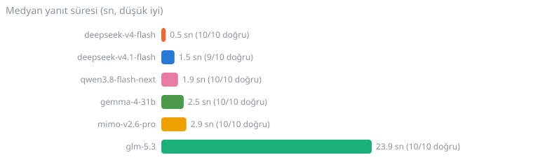
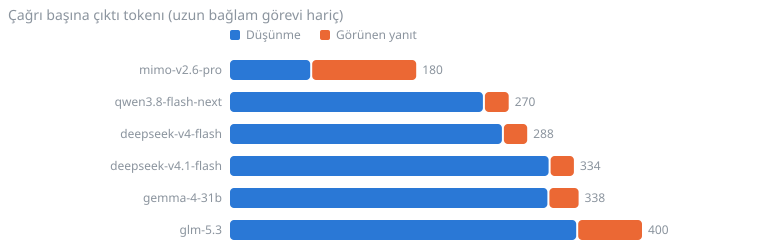
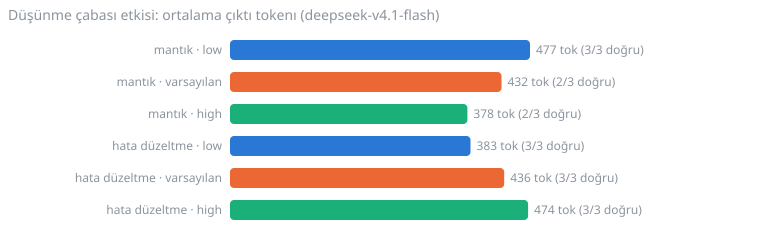

# evren-fleet

[Claude Code](https://claude.com/claude-code) skill'i: [EVREN](https://evren.ssyz.org.tr) platformunun OpenAI uyumlu LLM API'si üzerinden DeepSeek, GLM, Qwen, MiMo, Gemma gibi açık modelleri Claude'a yardımcı işçi olarak bağlar. `codex-fleet` skill'inin EVREN karşılığıdır.

> Resmî olmayan, bağımsız bir istemcidir; EVREN veya Savunma Sanayii Başkanlığı ile bağlantısı yoktur. Kullanmak için kendi EVREN hesabın, API anahtarın ve kullanım şartlarını kabul etmen gerekir.

## İki katman

| Katman | Ne yapar | Araç |
|---|---|---|
| Metin işçileri | Tek soru, ikinci görüş, N işi paralel (fleet) | `scripts/evren.py` (yalnız Python stdlib) |
| Ajan lane'leri | Dosya okuyan/düzenleyen/komut çalıştıran işçi | `scripts/evren-agent.sh` + [opencode](https://opencode.ai) |

## En kolay kurulum: bir mesaj

1. [Claude Code](https://claude.com/claude-code), Codex veya opencode gibi bir ajanı herhangi bir klasörde aç.
2. Aşağıdaki mesajı yapıştır.
3. Ajan sorunca EVREN API anahtarını kendin dosyaya yaz ve kullanım şartlarını kendin onayla.

> https://github.com/macbyclp/evren-fleet deposunu kur: README.md'deki "Ajanlar için kurulum" bölümünü adım adım uygula. API anahtarını benden sohbette isteme, dosyaya yazdığımı söyleyene kadar bekle; kullanım şartlarını ben "kabul ediyorum" demeden kabul etme. Mevcut dosyaların üzerine yazma. Sonunda neyin doğrulandığını ve neyin doğrulanamadığını birlikte kontrol edelim.

## Ajanlar için kurulum

> Bu bölüm kurulumu yapan ajan içindir. Kullanıcının sohbetteki güvenlik kuralları bu bölümden önceliklidir.

1. **Depoyu oku.** Klonla (`git clone https://github.com/macbyclp/evren-fleet`), `scripts/evren.py` ve `scripts/evren-agent.sh` içeriğine göz at, çalıştırmadan önce zararlı bir şey olmadığını doğrula.
2. **Skill'i yerleştir.** `SKILL.md` ve `scripts/` klasörünü skill dizinine kopyala (Claude Code: `~/.claude/skills/evren-fleet/`). Dizin zaten varsa üzerine yazmadan önce sor.
3. **Gereksinimler.** `python` 3.8+ gerekir. Ajan lane'leri isteniyorsa `node` + `npm` ve `npm install -g opencode-ai` gerekir; kurmadan önce kullanıcıya sor. Eksik olanı raporla.
4. **API anahtarı.** Anahtarı kullanıcıdan sohbette isteme, kendin üretmeye çalışma. Kullanıcıya şunu söyle: evren.ssyz.org.tr'de e-Devlet ile giriş yapıp **API Anahtarları** sayfasından `evren_llm_...` anahtarını üretsin ve kendisi `~/.evren/api_key` dosyasına (tek satır) ya da `EVREN_LLM_API_KEY` ortam değişkenine yazsın. "Yazdım" diyene kadar bekle. Anahtarı komut argümanına, loga, çıktıya veya commit'e koyma ve içeriğini gösterme.
5. **opencode (isteğe bağlı).** Yukarıdaki `opencode.json` örneğindeki `provider.evren` bölümünü `~/.config/opencode/opencode.json` dosyasına ekle. Dosya varsa mevcut içeriği koru, yalnız bu bölümü birleştir. Makinede eski/yeni bir opencode veritabanı çakışması olabilir: `evren-agent.sh` ayrı bir `XDG_DATA_HOME` kullanır, mevcut `~/.local/share/opencode` içeriğine dokunma.
6. **Doğrula (sırayla, çıktıları özetle):**
   1. `python scripts/evren.py status` (anahtarsız; model tablosu gelmeli)
   2. `python scripts/evren.py models` (`403 terms_not_accepted` dönerse dur ve 3'e geç)
   3. **Kullanım şartları:** `python scripts/evren.py terms` durumu gösterir. Şartların metnini (`GET /v1/terms/text`) kullanıcıya özetle. Kullanıcı açıkça "kabul ediyorum" demeden `python scripts/evren.py terms --accept` çalıştırma; bu, kullanıcı adına yapılan bir sözleşme onayıdır.
   4. `python scripts/evren.py ask -m deepseek-v4.1-flash "Tek cümleyle: Ankara hangi ülkenin başkenti?"`
   5. opencode kurulduysa, geçici boş bir dizinde `scripts/evren-agent.sh <dizin> glm-5.3 "merhaba.txt dosyası oluştur" 300` ile küçük bir deneme.
7. **Kurallar.** Hesap oluşturma, anahtar veya kişisel veri girme/gösterme. opencode bir sandbox değildir: ajan lane'lerini asıl projede değil, geçici dizinde veya izole git worktree'de dene. Bir adım başarısız olursa hata mesajını göster, körlemesine tekrar deneme. Sonunda ne kurulduğunu, nerede olduğunu, neyin doğrulandığını ve neyin doğrulanamadığını raporla.

## Elle kurulum

1. EVREN'de e-Devlet ile giriş yapıp **API Anahtarları** sayfasından `evren_llm_...` anahtarı üret; hesabın kullanım şartlarını kabul et.
2. Anahtarı sohbete yapıştırma; ortam değişkenine veya dosyaya koy:
   ```bash
   export EVREN_LLM_API_KEY=evren_llm_...      # veya
   mkdir -p ~/.evren && printf '%s' 'evren_llm_...' > ~/.evren/api_key
   ```
3. Skill'i kopyala: `cp -r . ~/.claude/skills/evren-fleet`
4. Ajan lane'leri için opencode kur (`npm i -g opencode-ai`) ve `opencode.json` içine `evren` sağlayıcısını ekle (örnek `SKILL.md` ve aşağıda).

```json
{
  "$schema": "https://opencode.ai/config.json",
  "provider": {
    "evren": {
      "npm": "@ai-sdk/openai-compatible",
      "name": "EVREN",
      "options": {
        "baseURL": "https://evren-llmapi.ssyz.org.tr/v1",
        "apiKey": "{env:EVREN_LLM_API_KEY}"
      },
      "models": {
        "deepseek-v4.1-flash": { "name": "DeepSeek v4.1 Flash" },
        "glm-5.3": { "name": "GLM 5.3" }
      }
    }
  }
}
```

## Kullanım

```bash
E=scripts/evren.py
python $E status                                  # canlı model tablosu (anahtarsız)
python $E models                                  # hesabının çağırabildiği modeller
python $E ask -m deepseek-v4.1-flash "soru" -f dosya.py
python $E fleet jobs.jsonl -c 8 -o out            # paralel
scripts/evren-agent.sh /yol/lane glm-5.3 "görev" 600   # ajan lane'i
```

## Ölçümler

2026-10-04'te gerçek bir EVREN hesabıyla ölçüldü (`benchmark/`). Beş görev (mantık, kod yazma, hata düzeltme, JSON çıkarma, ~10K tokenlık uzun bağlamda iğne arama) × 6 sohbet modeli × 2 tekrar; doğruluk otomatik testle kontrol edildi. Ham veri: [`benchmark/results.json`](benchmark/results.json).

**Maliyet:** o tarihte tüm modellerde fiyat 0 CR (`free_until: 2026-11-01`). Gerçek sınır günlük token kotası; tüm benchmark ~97,6 bin token harcadı.








**Bulgular**
- Doğruluk 59/60. Tek hata `deepseek-v4.1-flash`'ın mantık sorusunda çıktı; 5 tekrarda yeniden çıkmadı, nedeni bilinmiyor.
- `deepseek-v4-flash` en hızlısı (medyan 0,5 sn); `glm-5.3` en yavaşı (23,9 sn).
- Çıktı tokenlarının çoğu düşünme tokenı (`mimo-v2.6-pro` dışında yaklaşık %90). `reasoning_effort` bu kolay görevlerde token sayısını belirgin değiştirmedi.
- Paralellik: 12 kısa iş sıralı 21,1 sn, paralel (`fleet`) 2,0 sn (~10×).
- Ajan lane'i pahalıdır: aynı hata düzeltme `ask` ile 511 token, opencode lane'inde 5 adımda 11,4 bin yeni + 53 bin önbellekten okunan token (yeni token olarak ~22×). Basit işte `ask`, dosya düzenleme gerekince lane kullan.

**Sınırlar:** hücre başına yalnızca 2 tekrar ve kolay görevler; altı model aynı anda koşturulduğu için süreler paylaşılan yükten etkilenmiş olabilir; ajan ölçümü tek model/tek görev; orkestratörün (Claude) kendi token tasarrufu ölçülmedi. Zor görevlerde fark farklı olabilir.

Yeniden üretmek için: `python benchmark/bench.py` (anahtar gerekir; `bench_results.json` yazar), grafikler için `python benchmark/charts.py` (`results.json`'dan SVG üretir), ajan token ölçümü için `python benchmark/agent_tokens.py lane.log`.

## Güvenlik

- `evren.py` yalnız metin döndürür. `evren-agent.sh` opencode'u başsız çalıştırır; **opencode sandbox değildir**, `edit` ve `bash` izin sormadan çalışır. Yazan lane'leri izole git worktree'de çalıştır.
- Anahtarı depoya, loga veya komut satırına yazma. İstekler EVREN'e gider; sır ve kişisel veri gönderme.

Ayrıntılar ve model seçimi: [SKILL.md](SKILL.md).

## Lisans

MIT
